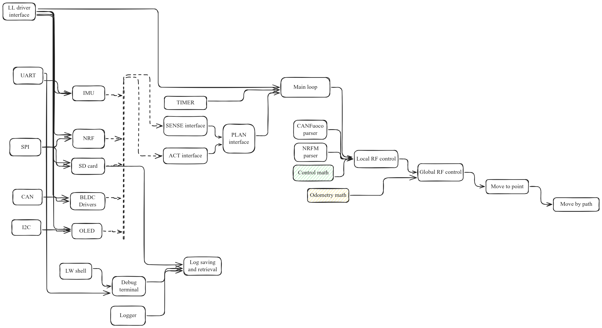

# Прошивка для FootBot 4
Программатор JLink. Чтобы поменять на ST-Link, надо изменить параметр в platformio.ini

## Важные моменты
Так как main - это cpp файл, то для корректной работы прерываний требуется extern "C". https://community.platformio.org/t/hal-delay-infinite-loop-due-to-return-0-from-hal-gettick/45129
## Стек: 
1. Platformio
2. HAL
3. letter-shell + extensions

## Стуктура исходного кода

https://web.archive.org/web/20231210061404/https://api.csswg.org/bikeshed/?force=1&url=https://raw.githubusercontent.com/vector-of-bool/pitchfork/develop/data/spec.bs

## Дерево технологий



## Заметки

### Компиляция letter-shell

Для компиляции letter-shell потребовались некоторые танцы с бубном. Во первых, для экспорта функций необходимо модифицировать файл линковки `.ld`.

Иначе комипилятор ругается на:

```
.pio/build/disco_f429zi/lib117/libletter-shell.a(shell.o): In function `shellInit':
shell.c:(.text.shellInit+0x7c): undefined reference to `_shell_command_start'
shell.c:(.text.shellInit+0x80): undefined reference to `_shell_command_end'
collect2: error: ld returned 1 exit status
```

Конкретно, интересующий файл лежал по пути `~/.platformio/packages/tool-ldscripts-ststm32/stm32f4/STM32F429ZITX_FLASH.ld`. Его надо скопировать в наш проект:

```bash
cp ~/.platformio/packages/tool-ldscripts-ststm32/stm32f4/STM32F429ZITX_FLASH.ld .
```

И в нем надо добавить строки:

```diff
  /* Constant data goes into FLASH */
  .rodata :
  {
    . = ALIGN(4);
    *(.rodata)         /* .rodata sections (constants, strings, etc.) */
    *(.rodata*)        /* .rodata* sections (constants, strings, etc.) */
    . = ALIGN(4);
+   _shell_command_start = .;
+   KEEP (*(shellCommand))
+   _shell_command_end = .;
    . = ALIGN(4);
  } >FLASH
```

После чего в `platformio.ini` надо указать этот кастомный файл:

```diff
...

+board_build.ldscript = STM32F429ZITX_FLASH.ld
```

### Компиляция log

При компиляции библиотек platformio, судя по всему, смотрит только на файлы из папки `src`. Файлы логгера находились в папке `extensions/log`, поэтому функции логгера не компилировались. Чтобы они смогли автоматически компилироваться нужные расширения были перенесены в директорию `src/extensions/`. Так они автоматически подхватываются и компилируются.

### Include path

Чтобы была возможность однокнопочного подключения заголовочных файлов, необходимо их пути добавить в флаги компиляции. Кроме как в `platformio.ini`, это можно сделать и в файле `library.json` в поле `build`, например вот так:

```json
{
    "name": "letter-shell",
    "version": "3.2.4",
    "keywords": "shell, embedded, command line, cli, console",
    "description": "Letter shell for embedded systems",
    "repository": {
        "type": "git",
        "url": "https://github.com/NevermindZZT/letter-shell.git"
    },
    "frameworks": "stm32cube",
    "platforms": "ststm32",
    "build": {
        "libArchive": false,
        "flags": [
            "-Isrc/",
            "-Isrc/extensions/cpp_support",
            "-Isrc/extensions/log"
        ]
    }
}
```

## UART с Raspberry Pi

Код: `src/devices/uart_control`. Парная сторона — `src/protocol/uart.py` в [fb4-runner](https://github.com/sigizmund993/fb4-runner); форматы должны совпадать (размер пакета проверяет `static_assert`).

Кадр в обе стороны: `[0xA5][payload][XOR от 0xA5 и payload]`.

| Направление | Формат (Python struct) | Поля | Кадр |
|---|---|---|---|
| RPi → STM | `<5eB??B` | vel_x, vel_y, w, dribbler, kicker [В] (fp16), kicker_mode, angle_mode, beep, robot_id | 16 байт |
| STM → RPi | `<Be??` | robot_id, напряжение кикера [В] (fp16), ball_deep, ball_front | 7 байт |
| RPi → STM, настройки | `<8f` | angle_k, angle_b, max_linear_vel, max_linear_accel, max_angular_vel, max_angular_accel, wheel_vel_p, wheel_vel_i (float32); NaN — по умолчанию | 34 байта, синхробайт `0x5A` |

Если формат меняется, прошивку, раннер и teleop надо обновлять вместе: кадры другой длины не распознаются, и робот стоит.

### Кадр настроек

Коэффициенты из стратегии (`SET_COEFFICIENTS` в `robot/control.proto`, поля STM32): `[0x5A][SettingsPacket][XOR]`, 34 байта. Раннер хранит коэффициенты и шлёт этот кадр раз в секунду, так что после сброса STM получает их снова.

- `angle_k`, `angle_b` — удержание курса: `w = ошибка × (angle_b + angle_k × |v|)`.
- `max_linear_vel`, `max_linear_accel`, `max_angular_vel`, `max_angular_accel` — ограничения в `Robot::act`.
- `wheel_vel_p`, `wheel_vel_i` — PID скорости колёс в моторах; отправляются по CAN (`setDriveSettings`) только при изменении.

NaN или отрицательное значение — значение по умолчанию (какое было до первого кадра настроек: из `device_manager.cpp` или EEPROM). Так кадр всегда задаёт полный набор, и убранный в стратегии коэффициент возвращается к умолчанию. Изменения пишутся в лог (`Settings from the RPi`). В EEPROM не сохраняется.

Напряжение кикера в обе стороны — вольты на конденсаторе. В команде это цель заряда: `0` — не заряжать, больше 330 В прошивка не даёт (`kicker::MAX_VOLTAGE`), отрицательное и NaN считает нулём. В телеметрии — измеренное напряжение: АЦП × 140 (делитель), предел измерения ≈462 В. Старое радио (nrf) по-прежнему шлёт уровень 0..15; `Robot::set_kicker_setting` переводит его в 100..330 В.

Угол: при `angle_mode = 0` `w` — угловая скорость [рад/с], гироскоп не участвует. При `angle_mode = 1` `w` — поворот [рад] от текущего курса, курс держится по гироскопу (BNO055). `w = 0` значит «держать курс»: цель запоминается в первом таком кадре (после `angle_mode = 0` или ненулевого `w`) и дальше не сдвигается, хотя кадры приходят каждые 10 мс. Раньше каждый кадр ставил цель «текущий курс + 0», и курс медленно уплывал.

Если 200 мс не приходит ни одного корректного кадра, робот останавливается (скорости, дриблер, кикер, писк) и переходит в `angle_mode = 0`, курс больше не держит.

### beep

Пищалка на PF13 пассивная: звучит, только пока пин переключается. Его переключает прерывание TIM7 на 2 кГц (`src/drivers/buzzer`), главный цикл только включает и выключает звук. Пищит, пока приходят кадры с `beep = 1`.

### robot_id

Id робота хранится только в hostname RPi (`fb4-NN`), в EEPROM STM его нет: id из EEPROM при загрузке не читается. Обе стороны шлют свой id в каждом кадре:

- После загрузки у STM id нет (`0xFF`), на экране `--`. STM берёт id от RPi с первого кадра.
- Исключение — id поменяли кнопками. Тогда STM игнорирует id от RPi, пока RPi не пришлёт этот же новый id (RPi берёт id STM, если он отличается дольше 1 с, и переименовывается в `fb4-NN`).
- `robot_id = 0xFF` (и всё больше 15) — у отправителя нет id, STM оставляет свой. Так шлёт teleop в режиме UART.

Ограничения:

- Id, выставленный кнопками, пока раннер не запущен, живёт до сброса STM.
- Звёздочка `*` на экране («id изменён кнопками») не гаснет до перезагрузки, даже когда RPi уже принял id.
